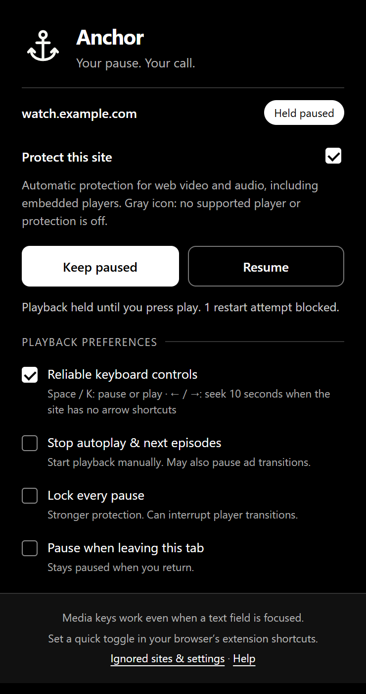
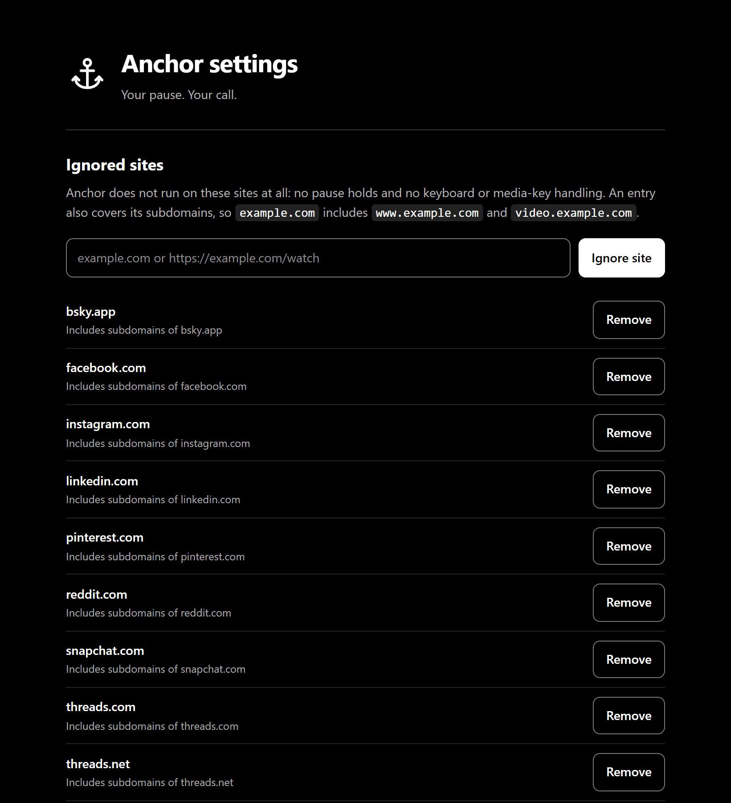

<div align="center">


# Anchor

**Paused should mean paused.**

A browser extension that holds your pause until *you* press play, then gets out of the way for everything else.

[](https://github.com/AdamNolle/Anchor/actions/workflows/test.yml)


[](LICENSE)

[Install](#install) · [How it works](#how-it-works) · [Ignored sites](#ignored-sites) · [Privacy](#privacy) · [Development](#development)

</div>

---

You pause a show to grab a drink. The player decides you didn't mean it: an ad ends, the stream reconnects, a script calls `play()`, and it starts again without you. Anchor stops that, without stopping the things you *do* want: the next episode, the video you click next, or the clips on the news page you're scrolling.

<table>
<tr>
<td width="44%" valign="top"></td>
<td valign="top">

### Features

- **Holds your pause.** Scripted restarts, reconnects and ad transitions can't resume a video you paused.
- **Autoplay that still works.** Next episodes, new titles and in-app navigation play normally. The hold belongs to the video you paused, not the whole site.
- **Polite on busy pages.** Pausing one news clip leaves the others alone, and muted autoplay clips never take over your Space bar.
- **Ignored sites.** Turn Anchor off for any site in one click. Social feeds are ignored out of the box.
- **Media keys everywhere.** Play/Pause, Play, Pause and Stop work even while you're typing in a text field.
- **Works with any HTML player.** Embedded iframes, shadow-DOM players and self-hosted servers like Jellyfin and Plex are detected automatically.
- **Private by design.** No network requests, telemetry, accounts or remote code.

</td>
</tr>
</table>

## Install

Anchor runs in desktop **Brave, Chrome, Edge, Vivaldi, Opera** and other Chromium browsers (version 119 or later) on Windows, macOS, Linux and ChromeOS.

1. Download **`anchor-1.3.0.zip`** from the [latest release](https://github.com/AdamNolle/Anchor/releases/latest) and extract it to a folder you'll keep.
2. Open your browser's extensions page (`brave://extensions`, `chrome://extensions` or `edge://extensions`) and turn on **Developer mode**.
3. Click **Load unpacked** and choose the extracted folder (the one containing `manifest.json`).
4. Pin Anchor to your toolbar. Tabs you already have open are protected right away.

> **Updating:** replace the folder's contents with the new release, then click **Reload** on Anchor's card in the extensions page. Your settings are kept.

## How it works

| You do this | Anchor does this |
| --- | --- |
| Pause with the player's button, <kbd>Space</kbd>, <kbd>K</kbd>, a media key or your OS media controls | Holds **that** video paused, including any replacement in the same spot (a new source or an ad-to-content swap) |
| The site tries to restart it | Blocks the restart quietly, the same way a browser rejects an interrupted `play()`, so players don't fall back to muted autoplay |
| Press Play, Resume, **Next episode**, or click the paused video | Releases the hold and lets it play |
| Open a different title, even inside the same app | Releases the hold, so the next video autoplays. Reloading the same page keeps the hold. |
| Click **Keep paused** in the popup | Holds every video in the tab, including ones that load later |

The toolbar icon shows a **white anchor on black** when it's protecting a player, and turns **gray** on ignored sites or pages without a player. While a video is held, the icon shows a <kbd>Ⅱ</kbd> badge.

### Optional per-site preferences

| Preference | Default | What it does |
| --- | :---: | --- |
| Reliable keyboard controls | On | <kbd>Space</kbd>/<kbd>K</kbd> play and pause the video you're watching. <kbd>←</kbd>/<kbd>→</kbd> seek 10 s on players that don't have their own arrow shortcuts. |
| Stop autoplay &amp; next episodes | Off | Every video waits until you start it, and the next episode waits when one ends. |
| Lock every pause | Off | Also holds pauses Anchor can't attribute to you. Stronger, but can interrupt buffering. |
| Pause when leaving this tab | Off | Pauses and holds media when you switch away. |

Keyboard shortcuts never fire in text fields, rich-text editors, sliders, menus, or on focused buttons and links.

## Ignored sites



Anchor doesn't run on ignored sites at all. Its code is never injected there.

- **Ignore the current site:** open the popup and turn off **Protect this site**.
- **Manage the list:** open **Ignored sites &amp; settings** from the popup. Enter a hostname, a full web address or an IP address. `example.com` also covers `www.example.com` and every other subdomain.

**Ignored by default:** X/Twitter, Facebook, Instagram, Threads, TikTok, Reddit, LinkedIn, Pinterest, Snapchat, Tumblr and Bluesky. Feeds autoplay and pause videos as you scroll and use <kbd>Space</kbd>/<kbd>K</kbd> for their own shortcuts, so Anchor stays out of the way. Remove any of them to turn protection on.

## Privacy

Anchor needs access to HTTP and HTTPS pages to find video and audio players, including those embedded from other sites. That access is used only on your device:

- No network requests, analytics, telemetry or accounts.
- No remote code. Everything Anchor runs ships in the extension.
- Settings live in your browser's local storage. Pause holds live in session storage and are deleted when the tab closes or the browser restarts.
- Anchor doesn't skip ads, bypass DRM, or modify what a site streams.

## Troubleshooting

<details>
<summary><strong>A video restarted after I paused it</strong></summary>

Some players use custom controls Anchor doesn't recognize. Use **Keep paused** in the popup, or turn on **Lock every pause** for that site.
</details>

<details>
<summary><strong>A site behaves strangely with Anchor installed</strong></summary>

Open the popup and turn off **Protect this site**. Anchor will stop running there immediately. Please [open an issue](https://github.com/AdamNolle/Anchor/issues) with the site name.
</details>

<details>
<summary><strong>Resume in the popup doesn't start the video after a reload</strong></summary>

Browsers require a click on the page before media can play with sound. Click the site's own Play button once.
</details>

<details>
<summary><strong>Media keys control a different tab or app</strong></summary>

Your operating system decides which app receives hardware media keys. Play the video once so its tab becomes the active media session.
</details>

<details>
<summary><strong>I want a keyboard shortcut for Keep paused / Resume</strong></summary>

Assign one at `brave://extensions/shortcuts`, `chrome://extensions/shortcuts` or `edge://extensions/shortcuts`. Avoid <kbd>Alt</kbd>+<kbd>Shift</kbd>+<kbd>P</kbd>, which Brave already uses.
</details>

## Development

No build step: the repository *is* the extension. Development needs Node.js 22+.

```sh
npm ci
npx playwright install --with-deps chromium
npm run check     # manifest, versions, references, syntax
npm test          # 108 browser checks with the real extension loaded
npm run package   # dist/anchor-<version>.zip for releases and the Chrome Web Store
```

Tests launch Chromium with Anchor installed in a throwaway profile and serve local media fixtures on intercepted URLs, so they need no network access or accounts. They cover streaming, news and social pages, ignored sites, settings migration, media keys, Media Session, iframes and shadow DOM. Set `ANCHOR_BROWSER` to a Brave or Edge executable to run the suite there. CI runs it on Windows, macOS and Linux.

| File | Role |
| --- | --- |
| `main.js` | Player engine, runs in the page at document start |
| `bridge.js` | Relays state between the page and the extension |
| `background.js` | Service worker: settings, holds, ignored sites, toolbar icon |
| `settings.js` | Shared defaults and site/URL helpers |
| `popup.*`, `options.*`, `help.html` | Extension UI |

See [TESTING.md](TESTING.md) for validation details and [CHANGELOG.md](CHANGELOG.md) for release notes.

## Limits

Anchor works with standard HTML `<video>` and `<audio>` players. It can't control native apps, Flash-style plugins, or players that deliberately override browser APIs. It's a playback convenience tool, not a security boundary. Unusual custom controls may need **Keep paused** or **Lock every pause**.

## License

[MIT](LICENSE) © Adam Nolle
